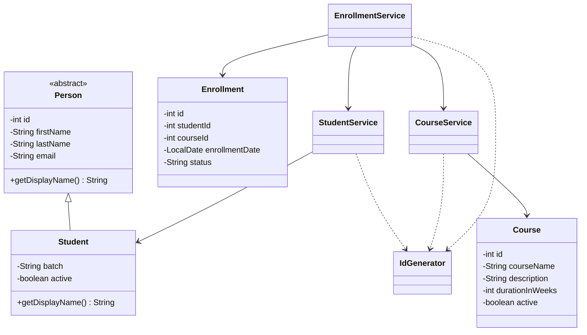

# LearnTrack — Student & Course Management System

A beginner-friendly, console-based Student & Course Management System built with Core Java. It manages students, courses, and enrollments using `ArrayList`. Data is stored in memory, so it resets when the application closes.

## Features

- Add, list, search, update, and deactivate students
- Add, list, search, and activate/deactivate courses
- Enroll active students in active courses
- View enrollments for a student
- Mark enrollments as completed or cancelled
- Validate user input and display friendly error messages
- Demonstrate encapsulation, inheritance, method overriding, constructor overloading, static members, collections, and custom exceptions

## Requirements

- JDK 17 or newer (the code uses standard Java features and no external libraries)
- A terminal or Java IDE such as IntelliJ IDEA, Eclipse, or VS Code

## Project structure

```text
LearnTrack/
├── src/
│   └── com/airtribe/learntrack/
│       ├── entity/       Person, Student, Course, Enrollment
│       ├── exception/   EntityNotFoundException, InvalidInputException
│       ├── service/     StudentService, CourseService, EnrollmentService
│       ├── ui/          Main
│       └── util/        IdGenerator, InputValidator
├── docs/
│   ├── Setup_Instructions.md
│   ├── JVM_Basics.md
│   └── Design_Notes.md
└── README.md
```

## Compile and run from the project root

### Windows (PowerShell or Command Prompt)

```powershell
javac -d out (Get-ChildItem -Recurse src -Filter *.java).FullName
java -cp out com.airtribe.learntrack.ui.Main
```

If the PowerShell command does not work in your terminal, compile all `.java` files from your IDE, or use the cross-platform commands below.

### macOS / Linux

```bash
mkdir -p out
find src -name "*.java" -print0 | xargs -0 javac -d out
java -cp out com.airtribe.learntrack.ui.Main
```

### IDE

1. Open the `LearnTrack` folder as a Java project.
2. Ensure the JDK is configured.
3. Mark `src` as the source folder if your IDE asks.
4. Run `Main.java` in `com.airtribe.learntrack.ui`.

## Class diagram



## Notes

- The application uses in-memory lists; no database or file persistence is configured.
- IDs are generated by static methods in `IdGenerator`.
- Enrollment status values are `ACTIVE`, `COMPLETED`, and `CANCELLED`.
- `Student` inherits shared person details from `Person` and overrides `getDisplayName()`.

See `docs/Setup_Instructions.md`, `docs/JVM_Basics.md`, and `docs/Design_Notes.md` for the requested documentation.
